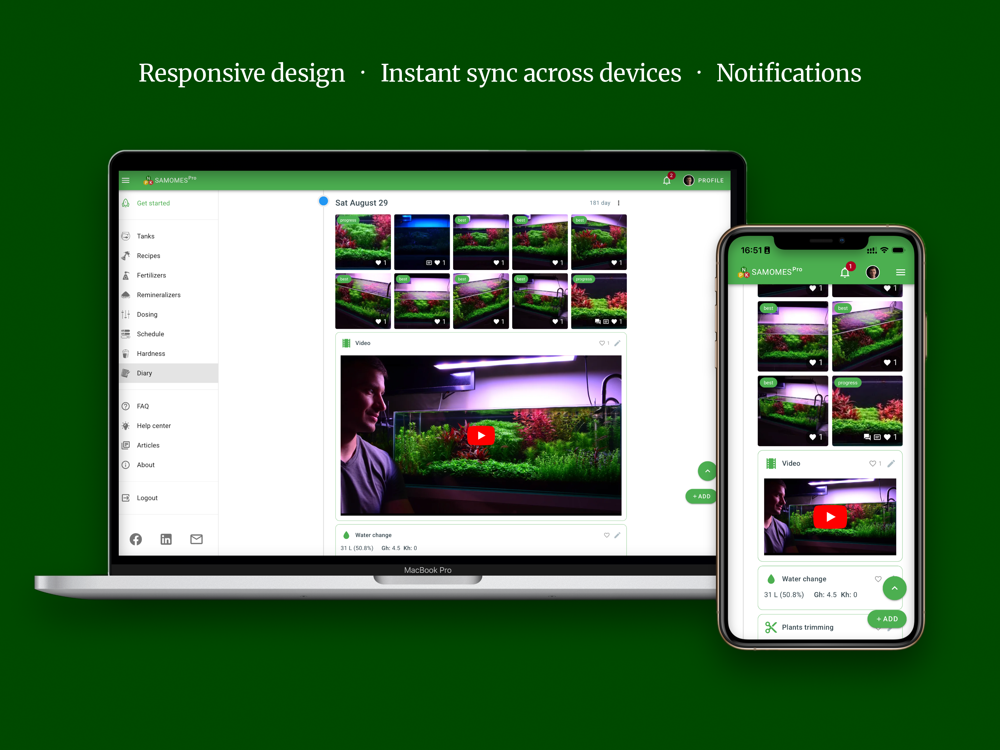
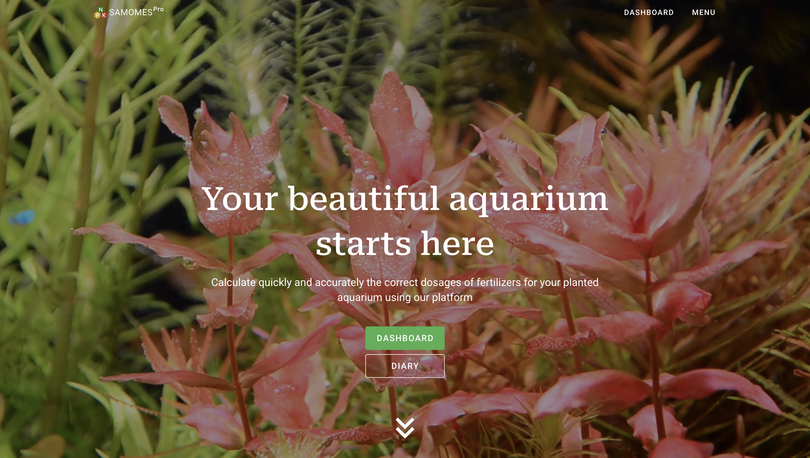
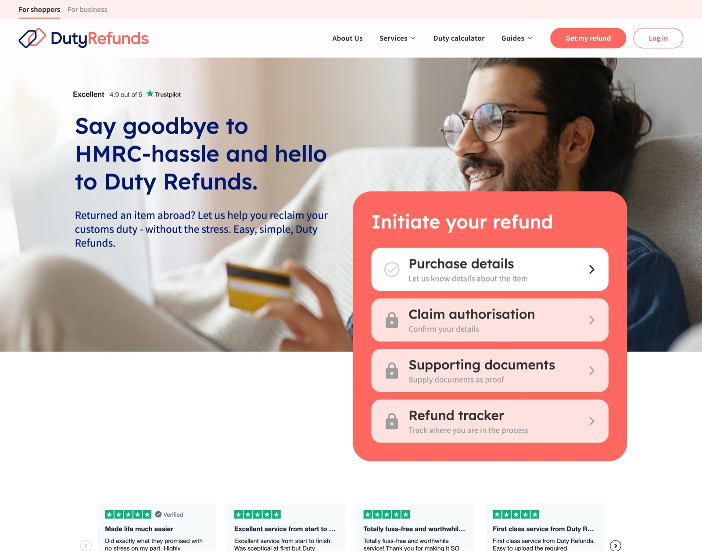
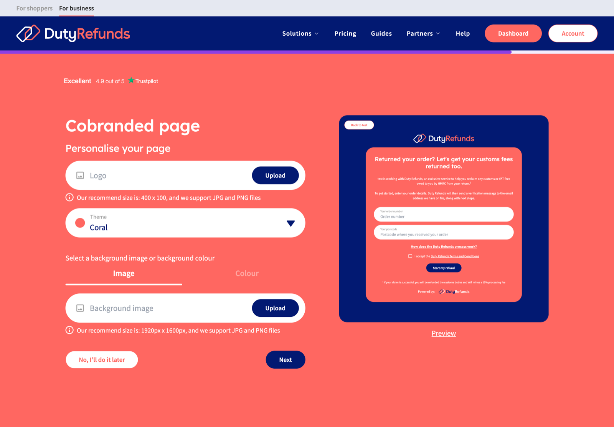
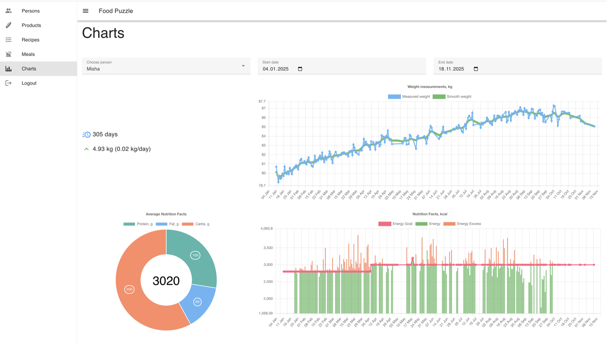
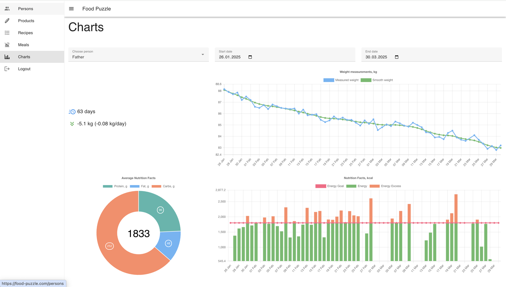
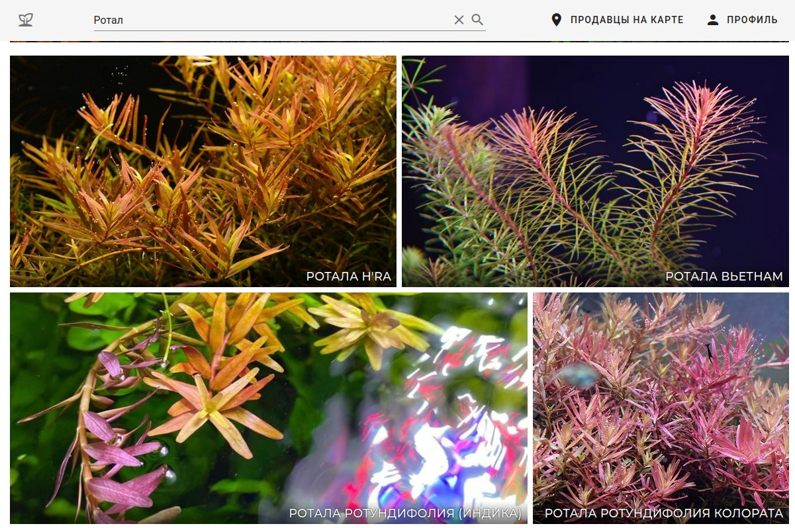

# Mikhail Lapshin

**Lead Frontend Engineer · Vue.js / Nuxt.js · TypeScript**

10+ years in software engineering. I build products end-to-end — architecture, frontend,
backend, payments, deployment — and I've shipped several of my own from idea to paying users.

Started with Python in 2015 (scrapers, NLP pipelines, Flask backends), moved through fullstack,
and consciously specialized in frontend because that's where the product actually meets people.
Since 2021 I've worked as a frontend lead: architecture, standards, testing, hiring, mentorship.

📍 Batumi, Georgia (GMT+4) · open to remote and relocation

---

## 🌿 Samomes — SaaS for aquarium hobbyists

**[samomes.com](https://samomes.com)** · Nuxt.js, Vuetify, Firebase, PWA

Fertilizer dosing for planted aquariums is genuinely hard chemistry, and most hobbyists do it in
spreadsheets or by guesswork. Samomes replaces that with interconnected calculators that solve the
whole system instantly.

That was the starting point. The platform has since grown a second half: aquarium journals, where
hobbyists document a tank over months, then publish that journal for others to follow and comment
on. Entries and individual photos each carry their own comments and likes.

Turning a single-user calculator into a multi-user product was the more interesting engineering
problem by a distance. Private-by-default content that users selectively publish means a real
sharing permission model, enforced in Firestore security rules rather than trusted to the client,
and denormalized counters so a feed doesn't read every comment and like just to render.

Started as an open-source tool, grew into a commercial product with paid subscriptions.
Built and run solo — frontend, Firestore data models, security rules, Cloud Functions, media
pipeline, billing, content, SEO.

- **229,000** pageviews last year — **+130%** year over year
- **7+ minute** average sessions — people work in it, they don't just land on it
- **48%** of traffic from organic search
- Shareable tank journals with comments and likes on entries and photos
- Freemium subscriptions via PayPal & YooKassa, full EN/RU localization
- Installable PWA — built for use standing at the aquarium, phone in hand

---

## 💼 Duty Refunds — UK import VAT refund platform

**[dutyrefunds.co.uk](https://dutyrefunds.co.uk)** · Vue 3, Nuxt 3, TypeScript, Tailwind, Playwright

Sole frontend lead in a team of 8, for close to three years. Owned the entire frontend direction —
architecture, standards, hiring, mentorship, and delivery process — across a multi-sided platform:
a B2C claim portal, a B2B merchant onboarding flow, and a Shopify app.

- Built the E2E testing infrastructure from scratch: **100+** Playwright scenarios across B2C and
  B2B, plus a TypeScript utility layer that made writing tests **2–3x** faster
- Cut code review time by **50%** while improving review quality
- Improved load speed by **40–50%** (SSR, image optimization, lazy loading, tree shaking)
- Redesigned the sprint as an overlapping release pipeline — urgent production fixes dropped from
  roughly weekly to once every few months
- Led the Vue 2 → Vue 3 / Nuxt 3 migration and built a themeable Tailwind component library
  documented in Storybook

---

## 🧩 Food Puzzle — calorie tracker with real composition math

**[food-puzzle.com](https://food-puzzle.com)** · Nuxt.js, Vuetify, Chart.js, Firebase, PWA

I'd used most of the commercial calorie trackers and kept hitting the same wall: they can log a
banana just fine, but they fall apart the moment you cook. So I built my own — MVP shipped in two
months, and I've been logging in it every day since January 2025.

The core problem it solves is portions of composed dishes. You cook a pot of something from ten
ingredients; it loses or gains weight in the pan; then you eat *some* of it. Most trackers make
you either pre-declare serving sizes or recalculate by hand. Food Puzzle lets you build a recipe
from products with a cooking yield factor, then drop that dish into a meal and just type the grams
you actually ate — it back-solves the nutrition from there. Composing complex dishes is easy, and
reusing them is easier.

- Products → recipes (with cooking yield) → meals, at any arbitrary weight
- Daily protein/fat/carbs and calories against a target, with excess tracked separately
- Body weight logged alongside intake, with a smoothed trend line over the noisy daily readings
- Multi-person tracking — one person can realistically maintain entries for several people
- Installable PWA

The multi-person mode wasn't a feature for its own sake — it was the design constraint. I added two
other people to the app — an older man and a young woman — specifically to prove the data entry
stayed fast enough that one person could keep several profiles logged without it becoming a chore.
If it survives that, it survives anything.

It also produced the result I'm most pleased with: the older man lost **5.1 kg in 63 days**
averaging 1,833 kcal a day. Look at the orange bars below: he went over target regularly. Nothing
was forbidden, nothing was weighed in misery; the food was simply structured well enough that the
deficit happened on its own.

---

## 🐟 Rastuchka — marketplace for live aquarium plants

**[rastuchka.com](https://rastuchka.com)** · Nuxt.js, Firebase, Vuetify

A niche marketplace connecting aquarium hobbyists across Russia. The core idea: buyers only ever
see what's actually in stock right now, and can find the nearest seller on a map.

Sellers pick items from a curated catalog instead of uploading their own photos — which solved a
real UX problem, since hobbyist photos of underwater plants are uniformly terrible. I shot most of
the catalog myself.

- Grew a community from **0 to 1,500** members in 3 months
- **80–100** active sellers on the map across Russia
- Built solo: frontend, backend, infrastructure, catalog, and community

---

## 📦 About the repository list

Most of what I've built isn't here, and that's deliberate. Samomes, Food Puzzle and Rastuchka are
live products carrying real user data — Samomes and Rastuchka went private once they picked up
paying users and payment flows, Food Puzzle once it started holding real people's health records.
Client and employer work is closed for the obvious reasons.

What's public are older side projects. The links above are where the actual work lives — all of it
in production, all of it something you can go click on right now.

---

## 📫 Get in touch

Open to senior and lead frontend roles — remote or relocation. I'm most useful on products with
real complexity behind the interface, where frontend is treated as engineering rather than
decoration.
